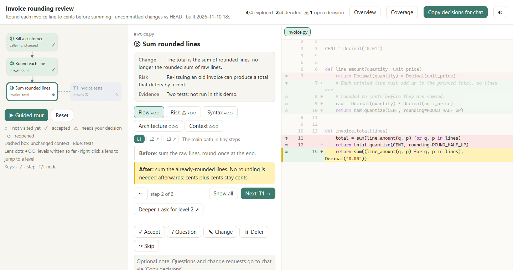
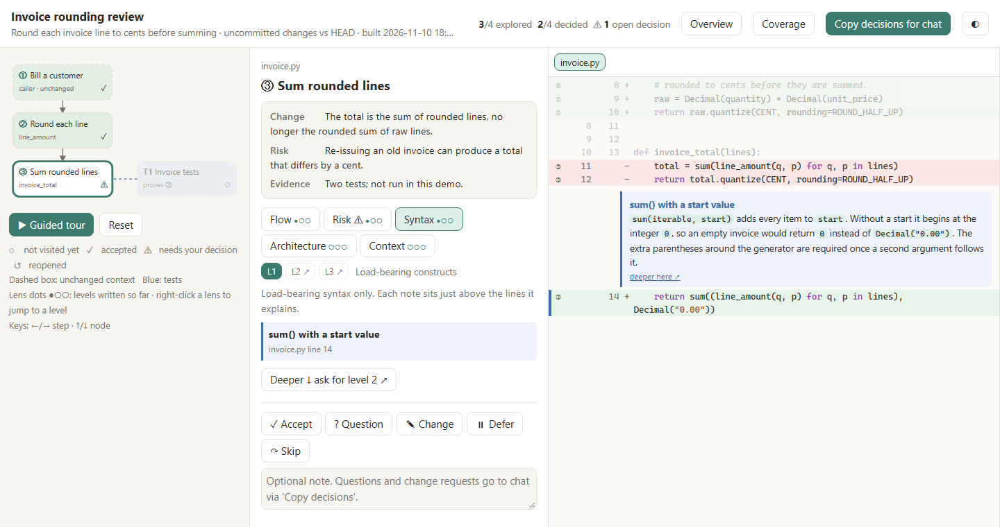

# review-lens

Review code changes made by an AI agent in a calm, local HTML page instead of
a long chat scroll.

The agent turns a diff into a page with three parts: a **flow map** of the change,
the **exact code** from git, and **lenses** (Flow, Risk, Syntax, Architecture,
Context) that go deeper only when you ask. You explore at your own pace, decide per
step (accept, question, change, defer, skip), and paste your decisions back into chat.





## Why

Reviewing an agent's work in chat tends to become either a wall of code or a
summary you have to take on trust. review-lens keeps both the overview and the
detail on one screen:

- **The map is home.** Each node is one step of the change, in execution order.
  Click one and its code lights up; hover a line and its node lights up.
- **Every node shows Change, Risk and Evidence**, so the essentials never hide
  behind a deeper lens.
- **Depth is on demand.** Flow and Risk level 1 are written up front. Everything
  else, up to three levels per lens, is written when you ask for it.
- **Nothing is silently skipped.** The build refuses to produce a page if a changed
  line belongs to no node, or if a changed file is neither reviewed nor declared
  unrelated. `--check` tells you when the code changed after the page was built.
- **Nothing leaves your machine.** The page is a single offline HTML file. Code is
  read from your local git repository and never uploaded.

## How a review flows

1. The agent implements a change, then writes a `content.json` describing the
   nodes and explanations, and builds the page.
2. You open the page and explore: guided tour, or click around freely.
3. Want more depth? Click a lens level marked ↗ (or right-click a lens tab). The
   page copies a request; paste it into the agent's chat. The agent writes the
   answer **into the page**; you refresh (F5). Your progress is kept.
4. Decide per node. **Copy decisions for chat** sends them back to the agent.
   Change requests lead to a fix; affected nodes get a new revision, and their
   earlier decisions show as ↺ reopened.
5. Commit-ready means: `--check` is up to date, every node is decided, and
   verification ran (or its limits were accepted).

## Requirements

- An agent that supports skills. Built for [Claude Code](https://claude.com/claude-code).
  `SKILL.md` follows the Agent Skills format, so other agents may work too, but
  that's untested.
- `git` and Python 3 on your PATH (tested with 3.13). The scripts use only the standard library.
- A modern browser.

## Install

Clone into your personal skills folder:

```bash
# macOS / Linux / Git Bash
git clone https://github.com/SamRFi/review-lens.git ~/.claude/skills/review-lens
```

```powershell
# Windows PowerShell
git clone https://github.com/SamRFi/review-lens.git "$HOME\.claude\skills\review-lens"
```

Claude Code picks it up automatically. Review pages are written to
`~/.claude/reviews/<repo>/<review-id>/`, outside your repositories.

## Suggested root instruction

The skill knows *how* to build a review. Your root instructions (for Claude Code:
`~/.claude/CLAUDE.md`) should say *when* to use it and what principles it serves.
A starting point to copy and adapt:

```markdown
## Human Review

After implementing a change, review it with the `review-lens` skill: a local,
offline HTML page (never uploaded, never written into the repository) with a
flow map, exact code from git, and lenses that deepen on request.

- **The page explains; chat decides.** Explanations, lens answers and changed
  conclusions go into the page. Chat carries requests, discussion and decisions.
  When I paste a page request, write the answer into the page, rebuild, and
  reply in one line.
- **Trivial changes** (a few lines, no judgment call) get a short chat summary
  instead: what changed, how it was verified, and that the page was skipped.
- **Every node shows Change, Risk and Evidence.** Material risks, assumptions
  and judgment calls are surfaced up front, never left for me to find through a
  deeper lens.
- **Accountability, not exhaustive reading.** Every changed line belongs to a
  node. Unrelated working-tree changes are declared and left untouched. Never
  imply I read code I didn't open.
- **Decisions are explicit.** Questions, silence or viewing code are not
  acceptance. Deferred and skipped are resolved with exceptions, never "accepted".
- **When I challenge something:** decide whether the intended contract changed
  or the implementation missed it, make the smallest safe correction, rerun
  affected verification, update the affected nodes (bumping their revision so
  earlier decisions reopen), and keep unaffected progress.

## Commit-Readiness

A change is commit-ready only when the review page's `--check` reports it up to
date, every node is accepted, deferred or skipped (none reopened or pending),
verification passed or its limits were accepted, and risks and unrelated changes
were surfaced. Never commit or push unless I ask.
```

## Building by hand

The agent normally does this, but you can too:

```bash
python ~/.claude/skills/review-lens/scripts/build.py path/to/content.json          # writes review.html next to it
python ~/.claude/skills/review-lens/scripts/build.py path/to/content.json --check  # stale? gaps? builds nothing
```

The `content.json` format is described in
[`reference/content-format.md`](reference/content-format.md). A review can cover
uncommitted work (including untracked files), one commit, or a range.

## Known limits

- The page can't talk to the agent: requests and decisions travel by copy-paste,
  and answers arrive by rebuild plus refresh. If the browser blocks clipboard access
  on `file://`, the page shows the text to copy by hand.
- Decisions are stored in the browser's localStorage for that page. Clearing site
  data loses them; the pasted decisions in chat are the durable record.
- Renamed files appear under their new path only. Binary files are listed as
  changed but not shown.
- Syntax highlighting covers C#, JS/TS/Vue, SQL, Python and PowerShell. Other
  files are shown as plain text.

## Repository layout

```
SKILL.md                     instructions the agent follows
reference/content-format.md  the content.json format
scripts/build.py             builds the page and checks coverage and staleness
scripts/diff_source.py       reads diffs and files from git or disk
scripts/template.html        the page itself (no external dependencies)
docs/                        screenshots
```
